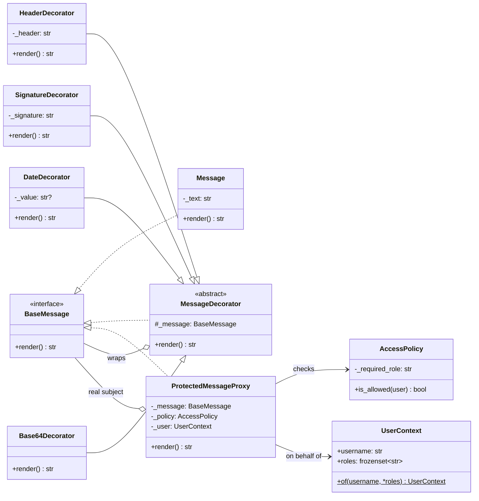

# Лабораторная работа № 2. Decorator и Proxy

## Что сделано

**Decorator** (`decorators/message_decorator.py`)
- `MessageDecorator` — базовый класс, хранит ссылку на `BaseMessage` и делегирует `render()`.
- `HeaderDecorator` — добавляет заголовок перед текстом.
- `SignatureDecorator` — добавляет подпись после текста.
- `DateDecorator` — добавляет дату (можно передать явно, иначе берётся `date.today()`).
- `Base64Decorator` — кодирует итоговую строку в Base64.

Все декораторы реализуют `BaseMessage` и свободно комбинируются в любом порядке и количестве.

**Proxy** (`proxies/protected_message_proxy.py`)
- `ProtectedMessageProxy` реализует `BaseMessage`, хранит ссылку на реальный субъект, `AccessPolicy` и `UserContext`.
- В `render()` проверяет права: если роль есть — делегирует вызов реальному объекту **без изменений**; иначе — возбуждает `PermissionError`.
- Не дублирует логику формирования текста.

**Демонстрация** (`app.py`)
- Цепочка декораторов.
- Base64 поверх всей цепочки.
- Proxy: успешный доступ (`alice` с ролью `reader`) и отказ (`bob` с ролью `guest`).

**Тесты** (`tests/`)
- `test_decorators.py` — каждый декоратор, комбинации, Base64, проверка `isinstance(BaseMessage)`.
- `test_proxy.py` — успешный доступ, отказ, отсутствие изменений в тексте, работа поверх декораторов.

**Документация** (`docs/`)
- `README.md` — назначение компонентов, сценарии, разница Decorator/Proxy.
- `class-diagram.md` — структурная диаграмма и sequence-диаграммы.
- `testing.md` — как запускать тесты.

---

## Структурная диаграмма



---

## Decorator и Proxy: сравнение

Оба шаблона реализуют тот же интерфейс, что и оборачиваемый объект, и хранят на него ссылку. Разница — в **назначении**.

| Критерий | Decorator | Proxy |
|---|---|---|
| Назначение | Расширить поведение | Управлять доступом |
| Меняет результат `render()` | Да | Нет |
| Типично обёрток | Цепочка из нескольких | Обычно одна |
| Кто знает об обёртке | Клиент собирает сам | Клиент обычно не знает |
| Типичная логика | Форматирование, кодирование | Проверка прав, lazy, кэш |
| Может не создавать объект | Обычно нет | Да (lazy proxy) |

**В этой работе:**
- `HeaderDecorator`, `SignatureDecorator`, `DateDecorator`, `Base64Decorator` — классические декораторы.
- `ProtectedMessageProxy` — классический proxy: не украшает сообщение, а решает, отдать ли его пользователю.

---

## Запуск

```bash
python -m pip install -e ".[dev]"
python -m pytest -v
python app.py
```

## Структура проекта

```
.
├── app.py
├── interfaces/
│   └── base_message.py
├── messages/
│   └── message.py
├── decorators/
│   └── message_decorator.py
├── proxies/
│   └── protected_message_proxy.py
├── security/
│   ├── access_policy.py
│   └── user_context.py
├── tests/
│   ├── test_message.py
│   ├── test_security.py
│   ├── test_decorators.py
│   └── test_proxy.py
└── docs/
    ├── README.md
    ├── class-diagram.md
    └── testing.md
```